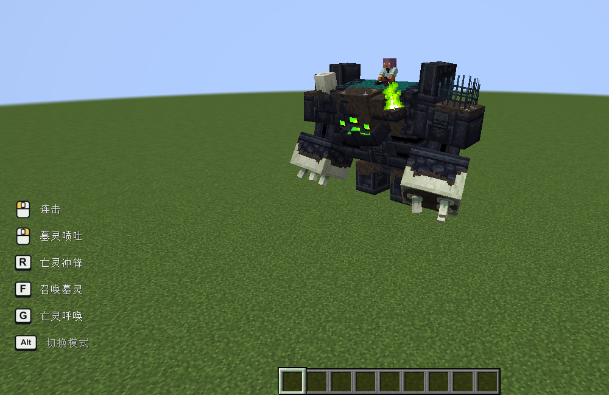

# Goety: Manual Riding

## AI disclosure

AI was used extensively during the development of this mod. Issues may still occur with different mod combinations and environments. If you do not trust AI-assisted projects, please think carefully before downloading and using it.

## Overview

Manually control the attacks and abilities of your Goety mounts.

## Usage

Mount a supported servant that belongs to you, then press **Left Alt** to switch between automatic and manual control.

- **Attack / Use**: basic attack / main ability.
- **R / F / G**: additional abilities, depending on the mount.
- **Dismount**: restore the mount's original AI.

The lower-left HUD shows the current bindings, abilities and cooldowns. Change bindings in **Options → Controls → Key Binds → Goety: Manual Riding**. This mod has no separate configuration file.

## Supported mounts

Bear Servant, Polar Bear Servant, Hoglin Servant, Gnasher, Ravager, Zombie Ravager, Trampler, Brood Mother and Redstone Monstrosity. The Forge version also supports Grave Monstrosity, which is not yet present in the tested Fabric and NeoForge versions of Goety.

Native ability cooldowns and summon limits still apply. Native Goety models, textures and animations are retained.

## Installation

| Minecraft | Loader | Required Goety version |
| --- | --- | --- |
| 1.20.1 | Forge 47.4.10 | Goety 2.5.60.6 |
| 1.20.1 | Fabric Loader 0.18.5 | [Goety-Fabric](https://modrinth.com/mod/goety-fabric) 0.7.0 |
| 1.21.1 | NeoForge 21.1.265 | Goety 3.2.2 |

Install on both the client and server, together with Goety's dependencies. The Fabric build requires Sh1roCu's unofficial Goety-Fabric port, Fabric API, Trinkets and Forge Config API Port.

## License and source

Code: **MIT**. Artwork: see [asset terms](LICENSE-ASSETS.md). Goety is made by [Polarice3](https://github.com/Polarice3/Goety-2). This addon requires Goety and does not bundle it.

## Feedback

If you encounter any issues, please leave a comment or join our QQ group. Include your Minecraft version, mod version, mod loader, and logs whenever possible to help us investigate.

Suggestions are also welcome! Your feedback will help guide improvements in future updates.

**QQ group:** 1095622706

**Support the author:** [Afdian](https://afdian.com/a/lbcm233)

## Development

See [BUILDING.md](BUILDING.md) for the build and development commands for each loader.

# 诡厄巫法：手动骑乘

## 制作说明

在该模组开发过程中广泛使用了人工智能。不同的模组组合和环境仍可能出现问题。如果你不相信AI辅助项目，下载使用前请三思。

## 简介

手动控制诡厄巫法坐骑的攻击与技能。

## 使用说明

骑上属于自己的受支持仆从，按 **左 Alt** 切换自动和手动模式。

- **攻击键 / 使用键**：普攻 / 主要技能。
- **R / F / G**：其他技能，按坐骑类型显示。
- **下马**：恢复坐骑原有 AI。

左下角显示当前按键、招式和冷却。按键可在「选项 → 控制 → 按键绑定 → 诡厄巫法：手动骑乘」中调整。本模组没有单独的配置文件。

## 支持的坐骑

熊、北极熊、疣猪兽、噬咬鲨、劫掠兽、僵尸劫掠兽、践踏者、育母蜘蛛和红石巨兽。Forge 版还支持墓灵巨兽，所测试的 Fabric 和 NeoForge 本体暂未加入该生物。

技能冷却与召唤数量限制沿用原模组。保留诡厄巫法原有模型、纹理和动作。

## 安装

| Minecraft | 加载器 | 所需诡厄巫法版本 |
| --- | --- | --- |
| 1.20.1 | Forge 47.4.10 | Goety 2.5.60.6 |
| 1.20.1 | Fabric Loader 0.18.5 | [Goety-Fabric](https://modrinth.com/mod/goety-fabric) 0.7.0 |
| 1.21.1 | NeoForge 21.1.265 | Goety 3.2.2 |

客户端与服务端均需安装，并安装本体所需的前置。Fabric 版使用 Sh1roCu 的非官方移植 Goety-Fabric，需同时安装 Fabric API、Trinkets 和 Forge Config API Port。

## 协议与来源

代码采用 **MIT**，美术资源见[素材使用条款](LICENSE-ASSETS.md)。诡厄巫法由 [Polarice3](https://github.com/Polarice3/Goety-2) 制作。本模组为其附属，不包含原模组。

## 反馈

遇到问题可在评论区或 QQ 群反馈，并尽量提供 Minecraft 版本、模组版本、加载器和日志，方便排查。

欢迎提出改进建议，反馈将用于后续更新。

**QQ 交流群：** 1095622706

**支持作者：** [爱发电](https://afdian.com/a/lbcm233)

## 开发

各加载器的构建与开发命令见 [BUILDING.md](BUILDING.md)。
